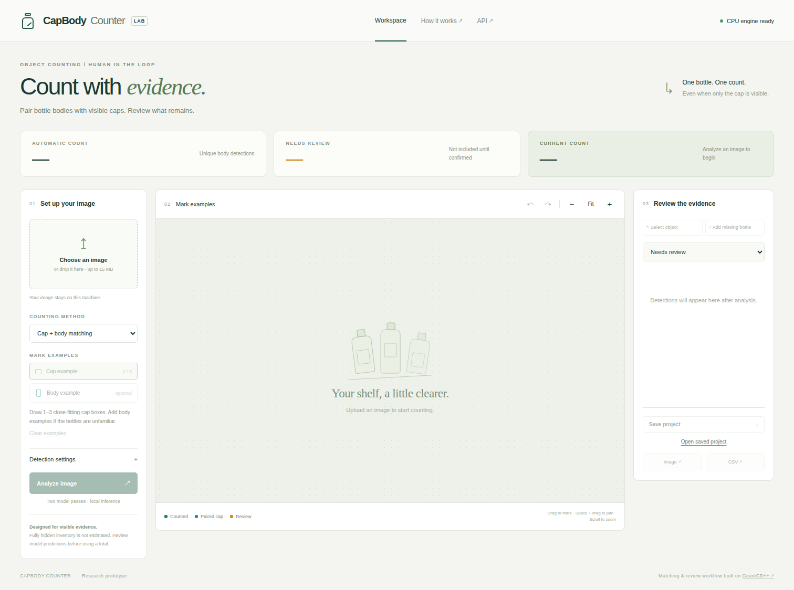
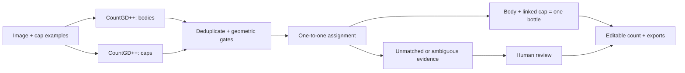

# CapBody Counter

**Count upright bottles with visible evidence, then resolve uncertainty yourself.**

A local, English-language review workspace built on the official
[CountGD++](https://github.com/niki-amini-naieni/CountGDPlusPlus) model.
CapBody adds geometric cap–body matching, one-to-one assignment, and an editable
counting report. It does not introduce a new neural architecture or pretrained model.



## What it adds

- Two inference passes: bottle bodies and caps, guided by 1–3 cap examples.
- Geometry-gated Hungarian assignment. A matched cap adds no second bottle.
- Conservative review: unmatched caps and short body proposals stay out of the count.
- Zoomable canvas, example marking, manual additions, cap–body pairing, dismissal,
  restoration, and undo/redo.
- Project JSON with the oriented image and review decisions, annotated PNG, and
  accepted-object CSV. Reports remain **provisional** while review items exist.
- The original text/exemplar counting API and an independent-count evaluation tool.



## Run locally

Use an existing Python environment. No new virtual environment is required.
The current installation uses `/home/sharif/Music/whisper/.venv/bin/python`.
Tested with Python 3.12, PyTorch 2.14.1, and Transformers 5.5.4 on CPU.

```bash
python -m pip install -r requirements.txt   # only if dependencies are missing
python prepare_local_weights.py
COUNT_PYTHON="$(command -v python)" ./serve.sh
```

Open **http://127.0.0.1:8091**. API documentation is at **/docs**.
The launcher uses `python3` by default; `COUNT_PYTHON` can name an existing
environment's Python executable. Model and tokenizer downloads require network
access during setup; image inference is local after setup.

1. Upload a PNG, JPEG or WebP image (15 MiB / 25 megapixels maximum).
2. Draw 1–3 close-fitting cap examples. Optionally mark up to three body examples.
3. Analyze. Green bodies contribute to the automatic count; teal caps are paired.
4. Review amber proposals. Confirm a cap as a separate bottle, pair it with a
   detected body, or dismiss it. Add a missing bottle by drawing its box.
5. Save the project or export PNG/CSV. Reopen project JSON to continue later.

**Controls:** scroll to zoom; Space + drag to pan; Fit to reset the view;
Ctrl/Cmd+Z to undo; Ctrl/Cmd+Shift+Z to redo. Changing examples or counting mode
clears the old analysis. Detection settings apply to the next analysis.
Images are normalized for EXIF orientation before marking examples, so displayed
coordinates and inference coordinates agree. Project files contain the image;
treat them as image data when sharing.

The installed user service remains `countgdplusplus.service`:

```bash
systemctl --user status countgdplusplus.service
systemctl --user restart countgdplusplus.service
journalctl --user -u countgdplusplus.service -n 50
```

For another machine, adjust the checkout and existing-Python paths in
`deploy/countgdplusplus.service` before installation. Optional overrides belong
in `~/.config/countgdplusplus.env`: `COUNT_DEVICE=cpu`, `COUNT_THREADS=4`,
`COUNT_PORT=8091`, `COUNT_PYTHON`, and `COUNTGD_WEIGHTS`.

## API and command line

`POST /count` retains its existing multipart contract: `file`, `prompt`,
`threshold`, `exemplars`, `negative_texts`, `negative_exemplars`, `include_image`.
Its results can also be viewed using **Standard CountGD++** in the workspace.

`POST /count/cap-body` accepts `file`, required `cap_exemplars` (JSON), optional
`body_exemplars` (JSON), `body_threshold`, and `cap_threshold` (both default 0.23).

```bash
curl -F file=@your-image.png \
  -F 'cap_exemplars=[[766,579,802,605],[864,548,904,577]]' \
  http://127.0.0.1:8091/count/cap-body

python local_count.py your-image.png --mode cap_body \
  --cap-exemplars '[[766,579,802,605],[864,548,904,577]]' \
  --output outputs/capbody
```

Replace those example coordinates with boxes on **your own image**. API/CLI
coordinates are pixels after EXIF orientation. CLI `--threshold` controls body
detections and `--cap-threshold` controls caps in cap–body mode.

The new response contains stable `objects` IDs (`b001`, `c001`, …), `links`, a
`summary`, raw-body `baseline`, thresholds, matching configuration, and model
provenance. Objects are `accepted`, `linked`, or `review`; user edits can also
mark them `rejected`. A linked cap never contributes an extra count. The API
returns proposals; the browser stores review decisions in exported project JSON.

## Matching rules

All initial constants live in `MatchingConfig` in `cap_body.py`:

| Rule | Initial setting |
| --- | --- |
| Within-role duplicate suppression | IoU > 0.5 |
| Minimum body height/width | 1.6; shorter proposals require review |
| Cap center relative to body top | −0.15 to +0.35 body heights |
| Maximum horizontal center offset | 0.6 body widths |
| Cap/body width ratio | 0.15–0.95 |
| Maximum cap/body height ratio | 0.35 |
| Assignment cost | 60% normalized horizontal + 40% normalized vertical distance |
| Maximum pair cost / ambiguity margin | 0.65 / 0.15 |

Hungarian assignment includes unmatched dummy columns. Near-equivalent
alternatives remain unpaired for review. IDs are ordered spatially after NMS.
No dimensions or matching constants were calibrated against an independent test set.

## Validation and limitations

On the one local refrigerator image used during development, the default
`plastic bottle` pass produced **22 raw proposals** and the example-guided cap
pass produced **32**. Matching yielded **12 automatic body detections**, **8 pairs**,
and **34 proposals awaiting review**, in roughly 12 seconds on CPU. These are
workflow observations on an unannotated image, **not accuracy or inventory totals**.
The earlier `beverage container` result of 49 uses a different target prompt and
is not a comparable accuracy baseline.

The initial scope is upright plastic beverage bottles. Cups, can tops,
reflections, unusual packaging, perspective and tilted bottles can cause errors.
Fully hidden inventory and physical shelf depth are not estimated. Model scores
are not calibrated correctness probabilities. “Review complete” means no
pending proposals remain; it does not establish ground-truth accuracy.

Compare count errors only against independently annotated images. Each input
to the evaluator is a JSON map such as `{"image-01": 12, "image-02": 8}`;
all three maps must contain identical image IDs. Keep automatic and manually
reviewed predictions in separate evaluations.

```bash
python evaluate_counts.py --truth truth.json --baseline baseline.json --cap-body capbody.json
```

The tool reports MAE, RMSE, signed bias and MAE change. It does not invent labels
or claim that cap–body matching outperforms CountGD++.

```bash
python -m unittest discover -s tests -v
node tests/review.test.mjs
# Optional browser suite, using an existing Playwright/Chromium installation:
PLAYWRIGHT_MODULE=/path/to/playwright/index.mjs CHROMIUM_PATH=/path/to/chromium \
  node tests/browser.mjs
```

Tests cover matching/ambiguity/duplicates, count invariants, API compatibility,
EXIF orientation, invalid inputs, review state, JSON round trips and exports.
The optional browser suite uses a local 1080×960 fixture at `data/test.png`
(override `CAPBODY_TEST_IMAGE` to point to the same fixture elsewhere) and makes
a real inference request. Private images, weights, project exports and browser
artifacts are excluded from Git. The README screenshot contains no uploaded image.

## Attribution and license

CapBody Counter's matching, web workspace, review state, API additions and
evaluation tooling are application contributions under MIT. The pretrained
architecture and weights are **CountGD++ by Niki Amini-Naieni and Andrew Zisserman**.
See [the paper](https://arxiv.org/abs/2512.23351), [upstream code](https://github.com/niki-amini-naieni/CountGDPlusPlus)
and [official weights](https://huggingface.co/nikigoli/CountGDPlusPlus).

The retained inference implementation includes compatibility changes for modern
Transformers and a PyTorch attention fallback. Weight downloads are pinned and
SHA-256 checked by `prepare_local_weights.py`; provenance is recorded locally.
Original notices are preserved in [LICENSE](LICENSE) and [NOTICE](NOTICE), with
Apache-licensed component terms in [licenses/Apache-2.0.txt](licenses/Apache-2.0.txt).
This is an application built on CountGD++, not a claim of authorship of that model.
